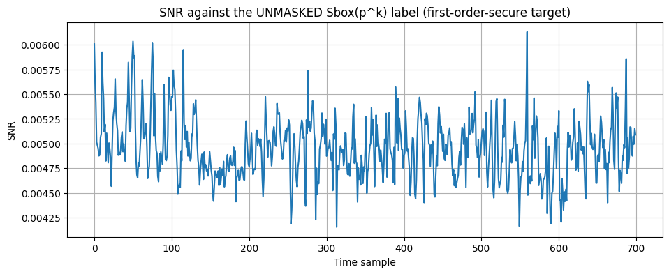
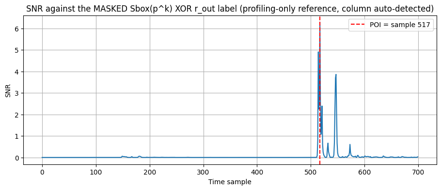
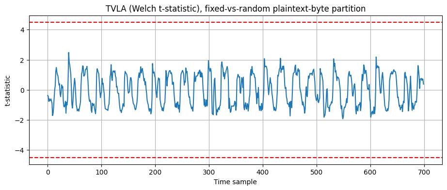
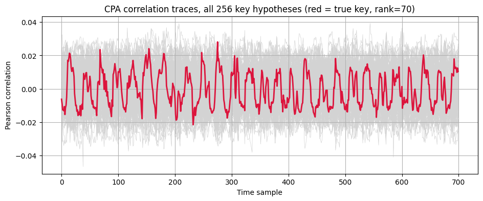
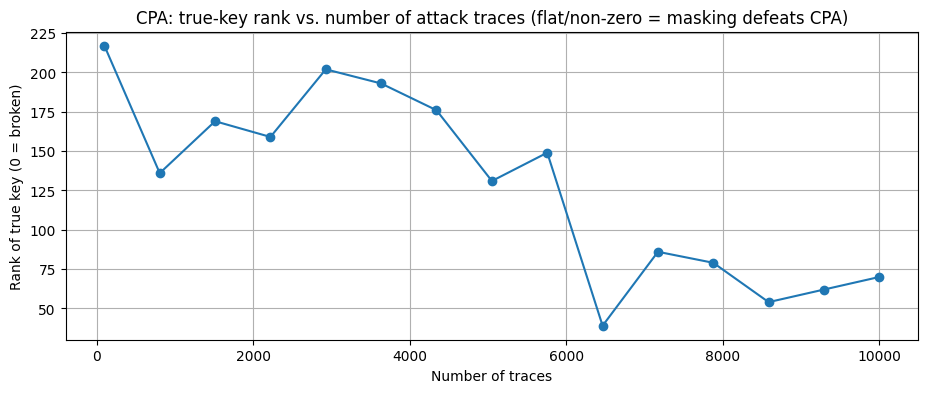
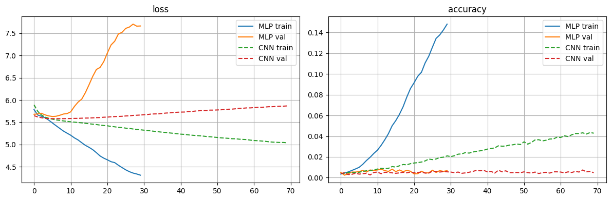
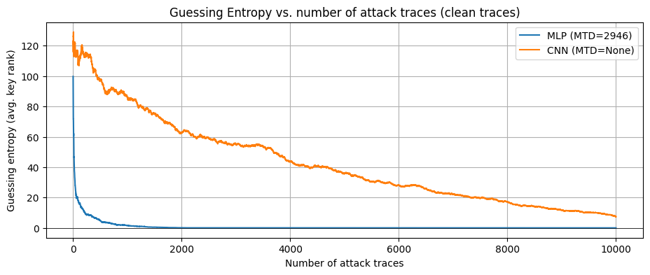
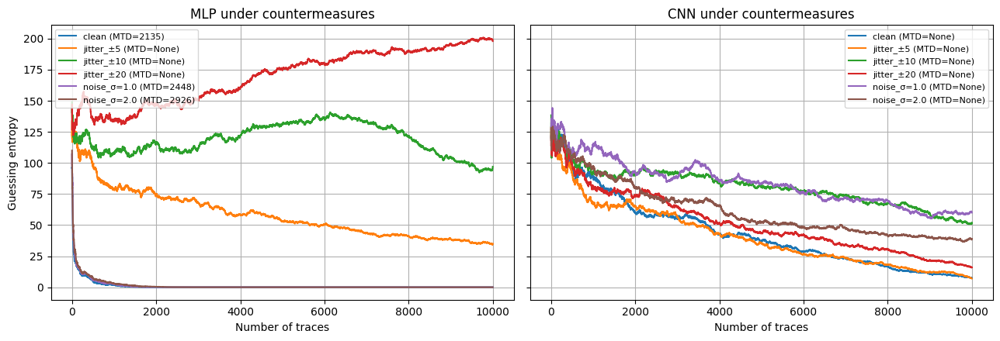
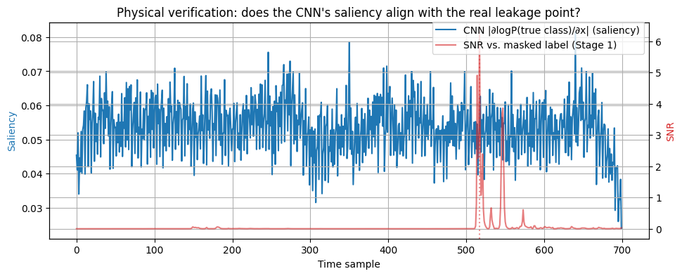

# Side-Channel Attack on Masked AES-128 with Neural Networks

This project looks at how well a protected (masked) AES-128 implementation holds up against side-channel attacks. The attacks use the electromagnetic traces of a chip while it runs encryption, not the cipher itself. The work is done in a single Jupyter notebook using the public ASCAD dataset.

The project follows the same steps a security evaluation lab would take: find where the device leaks, try the standard attack, try a stronger attack based on neural networks, measure how many traces the attacker needs, and finally see how much extra protection jitter and noise would add.

## Table of contents

1. [Background](#background)
2. [Dataset](#dataset)
3. [What the notebook does](#what-the-notebook-does)
4. [Results](#results)
5. [Summary of findings](#summary-of-findings)
6. [Limitations](#limitations)
7. [Repository layout](#repository-layout)
8. [How to run](#how-to-run)
9. [References](#references)

## Background

A chip that performs encryption gives off small physical signals, such as power use or electromagnetic emissions, that depend on the data it is working on. An attacker who records these signals can sometimes work out the secret key. This is called a side-channel attack.

Masking is a common defence. The chip combines every sensitive value with a random number (the mask) that changes on each run, so that no single point in the recorded signal is directly linked to the secret. Masking is meant to defeat simple attacks, but it can still be broken by attacks that look at two points at once, for example the mask and the masked value. Neural networks can learn to do this on their own, which is why they are of interest here.

The attacker in this project is a "profiling" attacker. They own a copy of the device and can record many traces with known keys and masks. They use this copy to train a model, and then attack a second device whose key is unknown. The question is how many traces are needed to recover the key.

## Dataset

The data comes from ASCAD version 1, fixed-key variant (file `ASCAD.h5`). It contains traces from a software-masked AES-128 running on an 8-bit ATmega8515 microcontroller.

| Item | Value |
|---|---|
| Profiling traces | 50,000 |
| Attack traces | 10,000 |
| Samples per trace | 700 |
| Target | S-box output of key byte 2, first round |
| Attack key byte (used only for scoring) | `0xe0` |

The dataset is not included in this repository. See [How to run](#how-to-run) for where to get it.

## What the notebook does

**Stage 1: Locate the leakage.** The signal-to-noise ratio (SNR) is calculated at every time sample, first against the plain S-box value and then against the masked value. A t-test (TVLA-style) is run as a second check for any leakage.

**Stage 2: Classical attack.** A correlation power analysis (CPA) is run on the attack traces. This is the first attack most labs would try.

**Stage 3: Neural network attack.** Two models are trained on the profiling traces: a fully connected network (MLP) and a one-dimensional convolutional network (CNN). The best training epoch is chosen with a key-recovery measure, not with validation loss.

**Stage 4: Measure how many traces are needed.** The models are used on the attack traces. The notebook reports guessing entropy (the average position of the correct key in the model's ranking) and the minimum number of traces to disclosure, MTD (how many traces it takes until the correct key is ranked first and stays there).

**Stage 5: Countermeasure test.** Clock jitter and random noise are added to the attack traces, and the attack is repeated. A saliency plot then shows which parts of the trace the CNN reacts to.

## Results

### Stage 1: Leakage analysis

Compared with the plain S-box value, the SNR stays at noise level across the whole trace (maximum 0.0061). This is what first-order masking is supposed to do.



Compared with the masked value, the SNR shows a sharp peak at sample 517 (maximum 6.29). The mask column was found by trying all 16 columns of the mask data and picking the one with the highest SNR (column 0). The device clearly handles the masked value at this point in time.



The t-test compares traces with one fixed plaintext byte against all other traces. No sample exceeds the usual threshold of 4.5 (0 out of 700). Note that this is an approximation of a proper fixed-versus-random test, because ASCAD was recorded with random plaintexts only.



### Stage 2: CPA attack

CPA does not find the key. After all 10,000 attack traces, the correct key byte `0xe0` is ranked 70th out of 256. The top guesses were `0x83`, `0x93`, `0xf3`, `0x08` and `0xc6`.



Using more traces does not fix this. The rank of the correct key moves around without settling near zero.



### Stage 3: Training the networks

| Model | Parameters | Epochs run | Best validation guessing entropy (300 traces) |
|---|---|---|---|
| MLP (6 hidden layers of 200 units) | 392,656 | 30 | 5.53 (epoch 10) |
| CNN (3 convolution blocks and 2 dense layers) | 413,424 | 70 | 103.0 (epoch 50) |

The MLP overfits quickly. Training accuracy climbs to about 15% while validation accuracy stays below 1%, and validation loss rises after the first few epochs. The weights from the epoch with the best guessing entropy were restored. The CNN learns much more slowly and its validation accuracy stays close to chance (1 in 256, about 0.4%).



Accuracy over 256 classes is a poor indicator of attack strength, so the next stage uses guessing entropy instead.

### Stage 4: Guessing entropy and MTD

| Model | MTD (clean traces) |
|---|---|
| MLP | 2,946 traces |
| CNN | Not reached within 10,000 traces |

The MLP recovers the key byte reliably after roughly 3,000 traces, even though CPA failed on the same data. The CNN's guessing entropy falls steadily but only reaches about 8 after 10,000 traces.



### Stage 5: Jitter and noise

| Condition | MTD (MLP) | MTD (CNN) |
|---|---|---|
| Clean | 2,135 | None |
| Jitter ±5 samples | None | None |
| Jitter ±10 samples | None | None |
| Jitter ±20 samples | None | None |
| Noise σ = 1.0 | 2,448 | None |
| Noise σ = 2.0 | 2,926 | None |

Even a small random shift of ±5 samples is enough to stop the MLP attack within 10,000 traces. Added noise at the levels tested raised the MTD only modestly.



The clean MLP value here (2,135) differs from the one in Stage 4 (2,946). Both are for the same model. The likely reason is that the two runs average over a different number of random trace orderings (50 here, 100 in Stage 4).

### Saliency

The saliency plot shows which samples the CNN's output reacts to most. The peak is at sample 640, which is 123 samples away from the leakage point found in Stage 1 (sample 517). The curve is broad and noisy and does not single out the real leakage point.



## Summary of findings

* The masking works against first-order attacks. The plain S-box value does not leak at any single sample, and CPA fails.
* A simple MLP still recovers the key byte in about 3,000 traces. Masking on its own is therefore not enough against an attacker who can build a profiling model.
* Random shifts of the trace (jitter) give far more protection than added noise in these tests.
* The CNN, in the form used here, did not recover the key and its saliency does not point to the real leakage. It would need a different design or more tuning. This should not be read as a general statement about CNNs, since published work has attacked ASCAD successfully with them.

## Limitations

* The jitter is simulated with a circular shift of each trace, which is a simplification of real hardware jitter.
* The noise levels (σ = 1 and 2) were applied to the raw traces before standardisation. Larger values were not tried.
* Only one key byte, one dataset and one random seed were used. Results will vary a little between runs.
* The t-test is a substitute for a full fixed-versus-random test, as explained above.
* The correct key byte is used only to score results (rank, guessing entropy, MTD). It is never used by the attack itself.

## Repository layout

```
.
├── README.md
├── requirements.txt
├── .gitignore
├── notebooks/
│   └── masked_aes_sca_deep_learning.ipynb
└── images/
    ├── 01_snr_unmasked_label.png
    ├── 02_snr_masked_label.png
    ├── 03_tvla_fixed_vs_random.png
    ├── 04_cpa_correlation_all_keys.png
    ├── 05_cpa_key_rank_vs_traces.png
    ├── 06_training_curves_mlp_cnn.png
    ├── 07_guessing_entropy_clean.png
    ├── 08_countermeasure_stress_test.png
    └── 09_cnn_saliency_vs_snr.png
```

## How to run

1. Get the ASCAD v1 fixed-key dataset (`ASCAD.h5`). It is published by ANSSI at <https://github.com/ANSSI-FR/ASCAD>. The notebook was run on Kaggle, where the file was attached as a dataset.
2. Install the requirements:

   ```
   pip install -r requirements.txt
   ```

3. Open `notebooks/masked_aes_sca_deep_learning.ipynb`. The notebook looks for the file in `/kaggle/input`, `/kaggle/working` and the current folder. If you run it somewhere else, set `ASCAD_PATH` in the data-loading cell to the location of your copy.
4. Run all cells in order. Training the two networks is the slow part and is much faster on a GPU.

## References

* Benadjila, R., Prouff, E., Strullu, R., Cagli, E., Dumas, C. *Deep learning for side-channel analysis and introduction to ASCAD database.* Journal of Cryptographic Engineering, 2020.
* Zaid, G., Bossuet, L., Habrard, A., Venelli, A. *Methodology for efficient CNN architectures in profiling attacks.* IACR TCHES, 2020.
